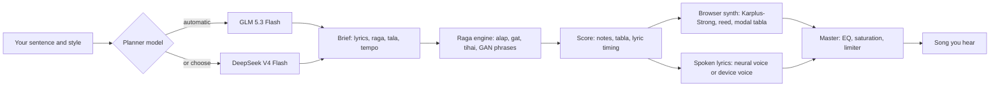
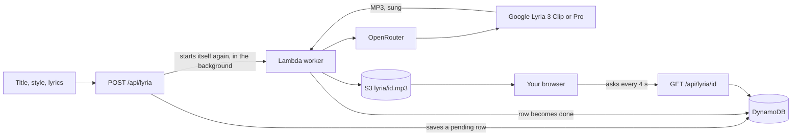
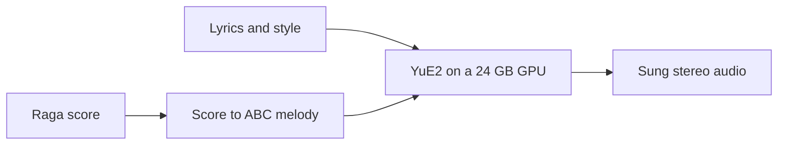
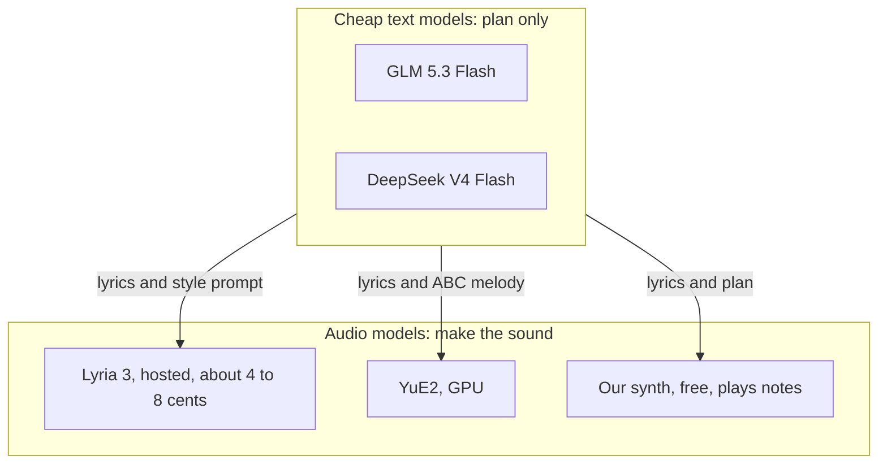

# Music, voice and video models: what makes what

mhRaaga makes a song in three jobs. Different models are good at different jobs, and **text models such as GLM and DeepSeek can only do the first one**. This page shows who does what, what each route costs, and which open-source libraries fit.

## The three jobs

| Job | What it produces | Models that can do it |
| --- | --- | --- |
| **1. Plan** | Lyrics, raga, tala, tempo, mood | Text models: GLM 5.3 Flash, DeepSeek V4 Flash (cents per thousand songs) |
| **2. Play** | The instruments: tanpura, bansuri, tabla, harmonium | Our engine plus the browser synth (free); or an audio model |
| **3. Sing** | A human-sounding voice on the melody | Only trained audio models: Google Lyria 3 (hosted), YuE2 (GPU), DiffSinger (needs a trained voice) |

A text model never makes sound. It writes the plan; something else turns it into audio.

## Route A: free, built from our own engine

Free to run. The planner costs a fraction of a cent. The voice **speaks** the words over the music; it does not sing them.

## Route B: a full AI song with a singer (Lyria 3)

| Model | What you get | Price |
| --- | --- | --- |
| Lyria 3 Clip | 30-second sung clip | $0.04 |
| Lyria 3 Pro | Full song, about 2 minutes | $0.08 |

These are the only two music models on OpenRouter (checked 17 November 2026). Limits: 3 songs per person per day, $2 per day for the whole site, counted on the *Users & cost* page.

## Route C: GPU singer you run yourself

YuE2 follows our raga melody. It does not run on Lambda (no GPU, 10 GB memory limit, 15-minute limit). Use the Colab notebooks in `singer/`, or a GPU machine you own. Hindi is not in its list of trained languages.

## Where the cheap models fit

Here is what that means in practice: choosing **DeepSeek or GLM** changes who writes the lyrics and the plan. It does not change how the song sounds, because the sound comes from the synth or from Lyria.

## Open-source libraries that fit this project

Licences and sizes were read from GitHub on 17 November 2026.

| Library | Licence | What it is for | Fit |
| --- | --- | --- | --- |
| [SpessaSynth](https://github.com/spessasus/SpessaSynth) | Apache-2.0 | Plays MIDI with real recorded instruments (SoundFont) in the browser | Best next step for a natural sound: swap our synthesized instruments for sampled ones, free to run |
| [FluidSynth](https://github.com/FluidSynth/fluidsynth) | LGPL-2.1 | Same idea as a native program | Server-side rendering; needs a native build for Lambda |
| [Piper](https://github.com/rhasspy/piper) | MIT | Fast local text to speech, CPU | Free spoken voice; speaks, does not sing |
| [DiffSinger](https://github.com/openvpi/DiffSinger) | Apache-2.0 | Singing-voice synthesis from notes and lyrics | The right kind of tool for free singing, but it needs a trained Hindi voice bank and a GPU to train |
| [AudioCraft (MusicGen)](https://github.com/facebookresearch/audiocraft) | MIT code, model weights are non-commercial | Text to instrumental music | Needs a GPU |
| [YuE](https://github.com/multimodal-art-projection/YuE) | see its licence | Lyrics to full song with vocals | Needs a 24 GB GPU; vendored in `third_party/YuE` |
| [pretty-midi](https://github.com/craffel/pretty-midi) | MIT | Read and write MIDI | Useful to export our score as a MIDI file |
| [music21](https://github.com/cuthbertLab/music21) | BSD-3-Clause | Music theory toolkit | Useful for checking notes and scales |
| [MoviePy](https://github.com/Zulko/moviepy) | MIT | Video editing in Python | Joins a song and pictures into a video, free |

**Video:** open models that generate video from text need large GPUs. The Film studio instead builds a storyboard, then cuts pictures to the song; MoviePy or ffmpeg can join the pieces.

## What each route can honestly do

| | Route A | Route B | Route C |
| --- | --- | --- | --- |
| Cost per song | about 0 | $0.04 to $0.08 | GPU time |
| Sung voice | no (spoken) | yes | yes |
| Hindi words | yes, spoken | mostly clear, some blur | not a trained language |
| Follows our raga | exactly | loosely, from the style words | follows the melody |
| Instrument realism | synthesized | studio-like | model-made |

If you want a free route that sounds natural, the next piece of work is replacing the synthesized instruments with SoundFont samples through SpessaSynth.
