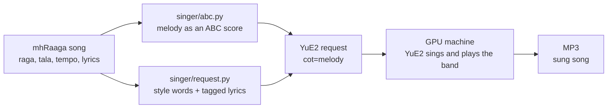

# The singer layer (YuE2)

mhRaaga's own voice **speaks** the words. A real **sung** vocal needs a singing model. The open **YuE2** model (vendored in `third_party/YuE`) can sing lyrics in a style over a band. The singer layer connects it to mhRaaga so the model sings **our raga melody** instead of inventing a tune.

**Status, plainly:** the layer is built and tested, and its output passes YuE2's own score check. **No song has been sung yet**, because the model needs a GPU and this project has none. Nothing paid has been started.

## How it fits

| File | What it does |
|---|---|
| `tool_layer_mhraga/singer/abc.py` | Writes the song's gat melody as ABC: two voices (Vocal and Ins), 4/4, sixteenth grid, Sa on G3 so the range suits a male voice, komal and tivra svaras as flats and sharps, ties across bar lines, groups of at most 4 bars as YuE2 requires. |
| `tool_layer_mhraga/singer/request.py` | Turns lyric tags (Mukhda, Antara, Chorus) into `[Verse]` and `[Chorus]`, builds the style line (language, your style words, voice, BPM) and attaches the score. |
| `tool_layer_mhraga/singer/colab_singer.ipynb` | A notebook that runs the request on **Google Colab's free GPU**. Also at https://www.mhraaga.in/singer/colab_singer.ipynb |
| `tool_layer_mhraga/singer/examples/tu_hi_tu.requests.json` | The two requests for the original Qawwali-style song (Devanagari and romanised lyrics). |
| `tool_layer_mhraga/gpu-worker/worker.py` | Optional queue worker for a GPU machine. Loads the model once, reuses it for every job, shuts the machine down after 15 idle minutes. |
| `api/jobs.py` | The queue: Admin > AI singer, or `POST /api/jobs {song_id, style}`. |

Checks that pass: the score of the Qawwali song is accepted by YuE2's own `abc_tools.py inspect` (28 bars, 77 notes, 70 s); every note in a generated score belongs to its raga (tested for Bhairavi and Yaman); `tests/test_singer.py`.

## How to hear it for free
1. Open https://www.mhraaga.in/singer/colab_singer.ipynb (download it, then in Google Colab choose File > Upload notebook).
2. Runtime > Change runtime type > **GPU**.
3. Run all cells. It makes two versions and downloads two MP3s.

**Free-tier limits:** the free GPU (a T4, 16 GB) is below the model's preferred 24 GB, so the notebook uses the model's low-memory mode and it may run out of memory. If it does, use a larger Colab runtime (paid) or ask for fewer lyric lines. YuE2 does not list Hindi among its trained languages, so Devanagari or romanised Hindi may be sung poorly; the notebook makes both spellings so you can compare.

## The paid options (not started)
A GPU machine such as an AWS `g5.xlarge` (24 GB) costs about **$1.21 an hour** in Mumbai. Use the worker (`tool_layer_mhraga/gpu-worker/README.md`). It is not needed for anything else on the site, and it shuts itself down when idle.

## Licence
YuE2 code: Apache-2.0. **Weights: free for personal use, creators and musicians (including monetising what you make) and for non-commercial work; companies need a licence from the authors.** See [THIRD_PARTY.md](THIRD_PARTY.md).

## Full AI songs with Lyria 3 (the hosted route)

The free routes above are either not built for Hindi singing (YuE2, needs a GPU) or only sing speech (the CPU prototype `tool_layer_mhraga/singer/cpu_sing.py`). The route that is switched on in the app is **Google Lyria 3 through OpenRouter**: about $0.08 for a full song, no GPU of ours.

- **Create page, "Full AI song with a singer"**: title, style, lyrics (or leave empty and the model writes them). `POST /api/lyria`, then `GET /api/lyria/{id}` until `status` is `done`; `GET /api/lyria/info` tells how many tries are left today.
- **Why two calls:** a song takes 20 to 60 seconds, longer than a web request may last. The request saves a row and starts the same Lambda again in the background; that run calls the model, saves the MP3 under `lyria/<random>.mp3` in the site bucket and marks the row done. It then shows in *My songs* (`source: "lyria"`, with an `audio` link and no score).
- **Limits (it costs money):** `LYRIA_USER_DAILY` (3) songs per user per day and `LYRIA_SITE_DAILY_USD` ($2) for the whole site per day. A failed song is not counted. Switch it off with the stack parameter `Lyria=off`.
- **Honest limits:** not driven by our raga engine; Hindi words are mostly sung right but some blur; the Android app lists these songs but cannot open them yet.
- **Code:** `api/lyria.py`, `web/lyria.js`, tests in `tests/test_lyria.py`.
