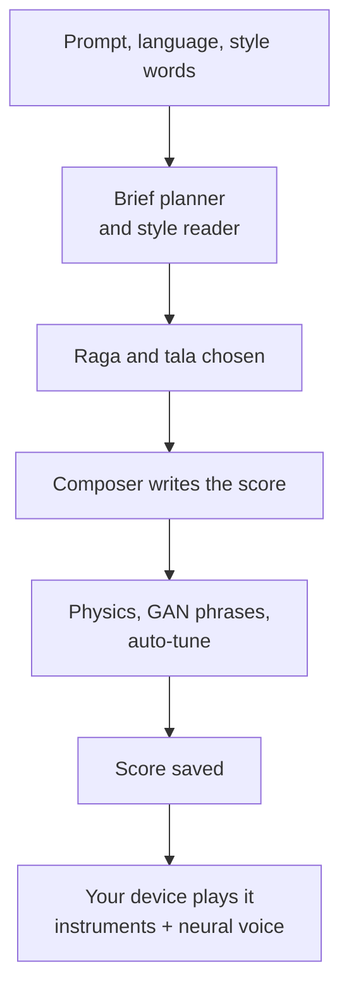

# The music agents

"Agent" here means a small piece of code that owns one decision or one judgement. None of them is an autonomous chatbot.

## 1. Producer agents (they choose)
Seven producers each choose **one gene** of a song. They choose by Thompson sampling (see [How the agents learn](LEARNING.md)): every option has a belief about how well it works for each language, the agent draws a random sample from each belief, and picks the highest.

| Agent | Chooses from | Judged by |
|---|---|---|
| `raga` | classical (30), gopi (1 to 16000), melakarta (1 to 72) | raga_fidelity, library_affinity |
| `tala` | teental, keherwa, dadra, rupak, jhaptal, ektal, adi | cadence, rhythm |
| `tempo` | 54, 62, 70, 80, 92, 104 bpm | rhythm, library_affinity |
| `lead` | bansuri, harmonium, veena | contour, phrase_variety |
| `theme` | dawn, krishna, rain, night (the words come from the verse bank) | lyrics_fit |
| `tonic` | 183, 233, 234 Hz | library_affinity, raga_fidelity |
| `form` | song or spoken poem | lyrics_fit, poem_form |

## 2. The composer
`compose.py` turns the seven genes into a score: alap, gat, tihai, tabla, lyrics. It is deterministic for a given seed. See [the engine](../ENGINE.md).

## 3. Critic agents (they judge)
Eight pure functions in `agentic/critics.py`. Each scores one aspect of a finished score from 0 to 1. Their weights in the song's reward:

| Critic | Asks | Weight |
|---|---|---|
| `raga_fidelity` | Do the notes belong to the raga, and are vadi and samvadi stressed? | 0.28 |
| `library_affinity` | How close is the note-class profile to the reference tunes? | 0.15 |
| `phrase_variety` | Are the phrases varied, not copies? | 0.14 |
| `contour` | Does the melody rise and fall in a singable shape? | 0.14 |
| `rhythm` | Does the tabla keep the tala? | 0.12 |
| `lyrics_fit` | Does the script match the language and the pacing fit? | 0.12 |
| `cadence` | Does the closing phrase land on sam? | 0.05 |
| `poem_form` | For poems: short rhymed lines and pauses | 0 (0.20 for a poem) |

For a spoken poem the weights change: `rhythm` becomes 0, `poem_form` 0.20 and `phrase_variety` 0.06. The critics are **rules, not listeners**; the reference tunes are only analysed for pitch-class profile and tempo, never copied.

## 4. The live agents (they run when you press Create)
These are ordinary services, listed so the picture is complete.

| Agent | File | Job |
|---|---|---|
| Brief planner | `brief.py` | Prompt, language and style words into raga, tala, tempo, mood, lead and lyrics (a language model, with keyword rules as a fallback) |
| Style reader | `styles.py` | Style words such as "sufi qawwali, dholak, handclaps" into lead, tala, tempo and extra players |
| Composer | `compose.py` | The score |
| Physics | `physics.py` | Rubato, note weight, meend glide and drift on Box2D |
| Phrase GAN | `gan.py` | New phrases, kept only if the discriminator accepts them |
| Auto-tune | `autotune.py` | Pulls pitch toward the shruti |
| Voice | `api/voice.py` | Neural speech for each lyric line |
| AI singer | `gpu-worker/worker.py` | Real sung songs with YuE2 on a GPU machine (optional, administrators) |
| Rules and learning | `api/studio.py` | The live rules and the learned defaults per language |

## 5. How one song moves through them

In the offline factory the first step is replaced by the seven producers, and after the composer the eight critics judge the score and the credit is shared.
