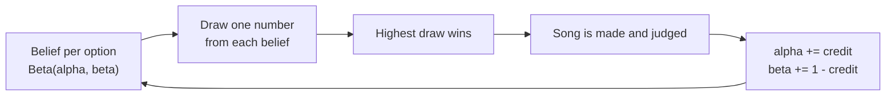

# How the agents learn

Source: `music_engine_framework_layer/mhraaga_engine/agentic/evolve.py` and `critics.py`. State is kept in `agentic/data/policy.json`.

## One round, step by step
1. **Choose.** For a language, each producer draws one random number from the Beta belief of every option it has and picks the option with the highest draw. Good options win more often; options with little evidence still get a chance, because their belief is wide.
2. **Compose.** The composer turns the seven genes into a song.
3. **Judge.** The eight critics score it. The song's **reward** is the weighted sum (weights in [the agents page](AGENTS.md)).
4. **Quality per agent.** Each producer's quality is the mean of the scores of the critics that judge its work (for example `tempo` is judged by `rhythm` and `library_affinity`).
5. **Share the credit.** Kalkee's Shapley function splits the song's reward among the producers (below).
6. **Update.** For the option a producer picked, its belief moves: `alpha += p` and `beta += 1 - p`, where `p` is its credit scaled so that an equal share equals the song's own reward and clamped to 0 to 1. Next time that option is a little more or less likely to be drawn.

## Thompson sampling in one picture
Every option holds a Beta(alpha, beta) belief that starts at Beta(1, 1), "no idea". Each success adds to alpha, each failure to beta. The mean is alpha / (alpha + beta). Drawing from the belief, not using the mean, is what keeps the agents exploring.

## The Shapley credit split
A song is the work of seven agents together. Giving the whole reward to the last agent, or splitting it evenly, would teach them the wrong thing. The **Shapley value** gives each agent the average of what it adds across every order in which the agents could have joined.
- The value of a group is modelled as a noisy-OR of its members' qualities: `v(S) = 1 - product(1 - quality_i)`. Two decent agents together are worth more than either alone, but not the sum.
- With up to 8 agents the value is computed exactly (there are 7 here); above that a Monte Carlo estimate is used.
- The reward is split in proportion to each agent's share, so the credits add up to the reward exactly.
- If every quality is about zero, the reward is split evenly so nothing divides by zero.

## The catalogue
- At most **100 songs**, about 14 per language (Hindi, Marathi, English, Telugu, Gujarati, Kannada, Tamil).
- A new song enters if its language has room, or if its reward beats the weakest song of that language by more than 0.003 (then it replaces it).
- **Improvement:** the weakest songs of each language are re-made with new seeds and one gene re-drawn from the beliefs; a variant replaces its parent only if it scores higher.
- At least three spoken poems per language are kept.

## What this does and does not do
It lifted the mean critic reward from 0.862 to 0.969 in the first runs. That is a number about the critics' rules. It is not a measure of how good a song sounds to a person. Listen, and use the Create page's Styles box to steer what the live site makes.
