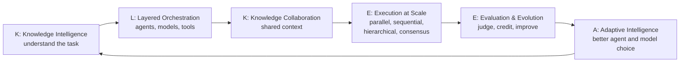

# KALKEE: Many Agents. Adaptive Intelligence. One Outcome.

**KALKEE** is an intelligent multi-agent orchestration and adaptive intelligence platform. It breaks a task into the work of specialised agents, runs them in the right pattern, judges the result, shares the credit fairly, and uses that credit to choose better agents and models next time.

## The full form

| Letter | Stands for | What it does |
|---|---|---|
| **K** | **Knowledge Intelligence** | Understands tasks, context, requirements and the knowledge available. |
| **A** | **Adaptive Intelligence** | Learns from feedback and improves how agents and models are selected. |
| **L** | **Layered Orchestration** | Coordinates agents, workflows, models and tools across layers. |
| **K** | **Knowledge Collaboration** | Lets specialised agents share context and work together. |
| **E** | **Execution at Scale** | Runs work in parallel, sequential, hierarchical and consensus patterns. |
| **E** | **Evaluation & Evolution** | Evaluates documents and outcomes, assigns credit, and keeps improving performance. |

## How the six parts fit together

1. **Understand (K).** Read the task, its context and requirements, and find the knowledge that applies.
2. **Orchestrate (L).** Pick the agents, workflow, models and tools, layer by layer.
3. **Collaborate (K).** Specialists pass context to each other instead of working alone.
4. **Execute (E).** Run the work in the pattern that suits it: parallel, sequential, hierarchical, or consensus among several agents.
5. **Evaluate and evolve (E).** Judge the documents and outcomes produced, assign credit to each agent for what it added, and keep improving.
6. **Adapt (A).** Feed that credit back so the next task starts with better agent and model selection.

## KALKEE in mhRaaga

mhRaaga is one application of this idea, in the music domain: seven producer agents choose a song's raga, tala, tempo, lead, theme, tonic and form, eight critics judge it, and the **Shapley value** shares the reward so each producer learns which choices work (the *Evaluation & Evolution* and *Adaptive Intelligence* parts). See [the music agents](AGENTS.md) and [how they learn](LEARNING.md).

mhRaaga uses only one function from KALKEE's code, `attribute_reward` in `framework/shapley.py`, and it runs offline in the song factory, not in the live site or API. The other parts of the platform described here are KALKEE's own and are not part of mhRaaga.
