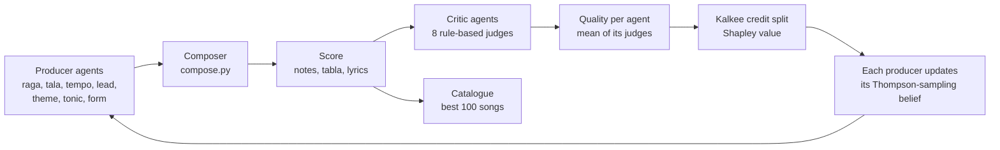

# Kalkee in mhRaaga

**Kalkee** is the agent layer of mhRaaga: a set of small specialist agents that each make one decision about a song, critics that judge the result, and a fair way to share the credit so every agent learns what it is good at. This page is about the music system only.

## What runs where
| Part | Where it runs | Uses Kalkee code? |
|---|---|---|
| Producer agents, composer, critics, catalogue | Offline, on a laptop or CI (`mhraaga_engine/agentic/`) | Yes: the credit split |
| Live site, API, Android app, AI voice, admin | AWS Lambda and your device | No |

**What mhRaaga takes from Kalkee is one function:** `attribute_reward` in Kalkee's `framework/shapley.py`, loaded by `agentic/evolve.py`. If the file is missing, a plain proportional split is used and the run records `local-fallback`. The rest of Kalkee (a general router and workflow engine) is not part of this product.

## Pages
- [The music agents](AGENTS.md): every agent, what it chooses or checks, and how a song moves through them.
- [How the agents learn](LEARNING.md): Thompson sampling, the critics' weights, the Shapley credit split and the catalogue rules, with the real numbers.
- [Every music file](../FILES.md): what each file holds.
